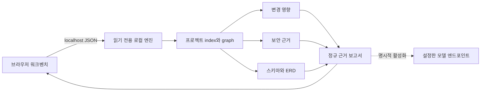

[English](README.md) | **한국어**

# Local Code Atlas

Local Code Atlas는 로컬 우선 코드 인텔리전스 워크벤치입니다. 프로젝트 디렉터리를 지정하고 변경 관련 질문을 입력하면 연결된 소스, Git, 보안, 테스트, 데이터베이스 근거를 한 보고서에서 확인할 수 있습니다.


결정론적 분석기가 발견 항목, 소스 위치, 신뢰도를 만들고, 선택적 모델 어댑터는 범위가 제한된 근거만 요약합니다. 모델 없이도 모든 기본 분석을 실행할 수 있습니다.

## 제공 기능

- 선택한 프로젝트에서 언어, 프레임워크, 패키지 관리자, 빌드 도구, DB 신호를 찾습니다.
- staged·unstaged·untracked·renamed 파일과 사용자가 고른 기준 리비전을 포함한 로컬 Git 상태를 읽습니다.
- 흔한 애플리케이션 언어의 파일, 심볼, import, 호출, 참조 그래프를 최선 범위에서 만듭니다.
- 자연어 변경 질문에 관련성이 높은 변경 표면을 정렬하고 프로젝트 상대 경로와 줄 근거를 붙입니다.
- 연관된 기존 테스트 또는 빠진 회귀 테스트를 제안합니다.
- 값은 반환하지 않고 자격 증명 후보를 탐지하며 위험한 SQL, 프로세스 실행, TLS, 암호화, 역직렬화, 설정 패턴도 찾습니다.
- npm, Python, Maven, Gradle, Cargo, Go의 직접 의존성을 수집합니다.
- 패키지 관리자를 실행하지 않고 pnpm, npm, Yarn lockfile에서 npm 직접·전이 버전을 해석합니다.
- 선택적으로 정확한 의존성 버전을 [OSV 권고](https://osv.dev/)와 대조합니다.
- SQL DDL·migration, Prisma, TypeORM, JPA에서 테이블, 열, 키, 선언·추론 관계를 얻습니다.
- 검색 가능한 ERD를 제공하며 관계의 선언 출처와 신뢰도를 분리합니다.
- 작업 트리·index·merge base 전후 SQL을 비교해 파괴적 DDL, 필수 열 전환, 타입 변경, cascade, 과거 migration 수정, 데이터 변경을 표시합니다.
- 변경 관련 근거와 전체 프로젝트 맥락을 구분하고 분석기 상태를 complete, partial, skipped, failed로 보여 줍니다.
- 번들 합성 fixture를 체크인된 영향·보안·스키마·migration 기대값과 비교하는 결정론적 Benchmark Lab을 제공합니다.
- 명시적으로 설정한 경우에만 선택·제한·redaction된 근거를 chat-completions 엔드포인트에 보내 요약합니다.

## 빠른 시작

요구 사항은 Node.js 22 이상, pnpm 11 또는 호환 버전, 변경 인식 분석용 Git입니다.

프로젝트를 처음부터 선택해 워크벤치를 실행하는 가장 짧은 흐름은 다음과 같습니다.

```bash
pnpm install
pnpm launch /absolute/path/to/project
```

launcher는 선택한 프로젝트 하나만 허용 루트로 둔 엔진을 시작하고, 필요하면 웹 프로세스를 시작한 뒤 워크벤치를 엽니다. 기존 엔진은 상태 계약이 같은 단일 루트를 확인할 때만 재사용합니다. 관계없는 서비스나 다른 루트 정책은 닫힌 상태로 실패합니다. 로컬 경로를 더하기 전에 `ATLAS_WEB_URL`도 루프백인지 확인합니다. 브라우저를 열지 않으려면 `--no-open`을 사용하세요.

hot reload 개발:

```bash
pnpm dev
```

브라우저 워크벤치는 [http://localhost:3000](http://localhost:3000), 읽기 전용 로컬 엔진은 기본적으로 `127.0.0.1:4317`에서 실행됩니다.

**Run bundled sample**을 선택하면 자신의 프로젝트 없이 전체 흐름을 확인할 수 있습니다. 샘플에는 의도적인 TLS·SQL 문자열 보간 위험, 세 테이블 관계 스키마, 세 migration 검토 항목이 있는 합성 전후 스키마가 들어 있습니다.

[http://localhost:3000/benchmark](http://localhost:3000/benchmark)에서 정확도 모음을 실행할 수 있습니다. Benchmark Lab은 매번 로컬 엔진 정체성을 확인하며 브라우저에서 프로젝트나 카탈로그 경로를 받지 않습니다.

## 명령줄 분석

CLI도 브라우저 API와 같은 정규 보고서를 출력합니다.

```bash
pnpm atlas /absolute/path/to/project \
  --base main \
  --question "If session expiry changes, what code, tests, risks, and tables are affected?" \
  --format markdown \
  --output atlas-review.md
```

주요 옵션:

- `--sample`: 번들 합성 프로젝트 분석
- `--staged`: Git index에 추가된 변경만 분석
- `--base <revision>`: 브랜치·커밋의 merge base와 `HEAD` 비교
- `--scope production|all`: 테스트, 예시, fixture, 문서, 생성·vendor 소스 포함 여부 선택
- `--osv`: 알려진 의존성 권고 조회 명시적 활성화
- `--ai`: 설정한 모델 어댑터로 근거 요약
- `--format json|markdown|sarif`: 보고서 형식 선택
- `--output <file>`: 선택한 형식을 파일에 기록
- `--question`, `-q`: 영향 질문 지정

## 분석기 정확도 측정

Benchmark Lab은 `benchmarks/` 아래 데이터 전용 매니페스트를 찾고 fixture를 순서대로 분석해 정규 라벨을 비교합니다. 영향, 보안, 스키마, migration 근거의 true positive, false positive, false negative, precision, recall, F1을 보고합니다. 분모가 0이면 완벽한 점수 대신 `N/A`로 표시합니다.

```bash
pnpm benchmark
pnpm benchmark --output benchmark-result.json
```

JSON에는 매니페스트·fixture 상대 경로만 들어갑니다. HTTP 엔드포인트는 정확히 `{ "suite": "bundled" }`만 허용하며 브라우저에서는 임의 benchmark 디렉터리를 지정할 수 없습니다. 실행 중 OSV와 모델 요약은 항상 꺼지고, 부분 분석 사례는 그대로 partial로 남아 빠진 라벨을 깨끗한 결과로 해석하지 않습니다.

## 개인정보 모델

로컬 분석이 기본이며 엔진은 프로젝트 빌드 hook을 실행하거나 저장소를 수정하거나 소스 내용을 영속 저장하지 않습니다.

| 기능 | 기기 밖으로 나가는 정보 | 기본값 |
| --- | --- | --- |
| 구조, Git, 영향, 소스 보안, ERD, migration 검토 | 없음 | 켜짐 |
| 번들 benchmark fixture와 지표 | 없음 | 요청 시 |
| OSV 권고 조회 | 패키지 생태계, 정확한 이름과 버전 | 꺼짐 |
| AI 요약 | 프로젝트 이름·감지 스택·질문·상대 근거 경로·제한 및 redaction된 영향·보안 근거·테이블과 열 이름 | 꺼짐 |

네트워크 기능은 체크박스나 CLI 플래그로 명시적으로 켜야 합니다. OSV 조회는 소스 경로나 내용을 보내지 않습니다. AI 요약은 운영자가 엔드포인트와 모델을 설정하기 전까지 사용할 수 없고, 워크벤치는 로컬 상태 계약에서 목적지 origin과 요청 범주를 확인한 뒤에만 동의받습니다. 실행 영수증은 전송 가능 필드와 실제 요청에 포함된 필드를 구분합니다.

모델 엔드포인트는 HTTP(S)만 허용하고, 루프백이 아닌 목적지는 HTTPS여야 하며, redirection을 거부합니다. 여러 사용자나 프로세스가 엔진에 접근할 수 있다면 `ATLAS_ALLOWED_ROOTS`를 설정하고 기본 루프백 호스트를 유지하세요. 인증 계층이 없으므로 비루프백 `ATLAS_HOST`는 허용 루트를 명시하지 않으면 시작하지 않습니다.

## 설정

기본값을 바꿀 때만 예시 파일을 복사합니다.

```bash
cp .env.example .env.local
```

| 변수 | 목적 |
| --- | --- |
| `ATLAS_HOST`, `ATLAS_PORT` | 로컬 엔진 bind 주소와 포트 |
| `ATLAS_ALLOWED_ROOTS` | 쉼표 또는 플랫폼 구분자로 나눈 검사 루트 |
| `ATLAS_ALLOWED_ORIGINS` | 엔진 호출을 허용할 브라우저 origin |
| `ATLAS_MAX_FILES` | 요청당 최대 색인 파일 수 |
| `ATLAS_MAX_FILE_BYTES` | 텍스트 파일 하나의 최대 읽기 바이트 |
| `ATLAS_MAX_TOTAL_BYTES` | 프로젝트 전체 검사 바이트 예산 |
| `ATLAS_LLM_BASE_URL` | chat-completions API base URL |
| `ATLAS_LLM_MODEL` | 실행 시 선택하는 모델 식별자 |
| `ATLAS_LLM_API_KEY` | 선택적 bearer 자격 증명 |
| `NEXT_PUBLIC_ATLAS_API_URL` | 브라우저가 접근할 로컬 분석기 URL |
| `ATLAS_WATCH_POLLING` | 기본 파일 이벤트를 쓸 수 없을 때 개발 서버 polling |

소스에는 모델이나 공급자를 고정하지 않습니다. 호환되는 로컬 엔드포인트는 API 키 없이도 사용할 수 있습니다.

## 아키텍처



브라우저는 파일시스템에 직접 접근하지 않습니다. 신뢰 경계와 분석기 계약은 [아키텍처](docs/architecture.md), 로컬 HTTP 계약은 [API 문서](docs/api.md)를 참고하세요.

## 개발

```bash
pnpm lint
pnpm typecheck
pnpm test
pnpm build
pnpm test:render
```

`pnpm check`는 전체 검증을 실행합니다. fixture는 합성 데이터이며 `tests/**/fixtures`, `examples/sample-project`, `benchmarks/fixtures`에 있습니다. 공개 알파와 확장 계획은 [roadmap](docs/roadmap.md)을 참고하세요.

## 현재 제한

- 정규식·규칙 기반 관계 분석은 최선 추정이며 runtime reflection이나 동적 import가 빠질 수 있습니다.
- 보안 발견은 검토 출발점이지 악용 가능성의 증명이나 안전 보증이 아닙니다. 깊은 interprocedural data-flow 증명은 현재 범위 밖입니다.
- CLI와 워크벤치의 소스 범위는 `production`, `all`이며 사용자 정의 규칙은 검증된 설정 파일이 추가되기 전까지 `ScanOptions.sourceScopeRules` 라이브러리 확장으로만 제공합니다.
- migration 작업 분석은 SQL을 지원합니다. 지원하지 않거나 너무 큰 문장은 깨끗한 결과 대신 partial로 표시하며 stored procedure와 vendor 전용 online DDL은 수동 검토가 필요할 수 있습니다.
- 명시적 실제 이름이 없는 ORM naming strategy는 inferred로 표시합니다.
- OSV 조회는 정확히 해석된 버전만 다룹니다. 지원 lockfile 없이 범위·floating reference만 있으면 제외하고 skipped coverage로 보고합니다.
- 실제 DB 연결은 지원하지 않으며 ERD는 저장소 소스에서만 만듭니다.
- benchmark 라벨은 안정된 정확 식별자를 사용하므로 의미상 같은 라벨을 자동으로 동일 취급하지 않습니다.

## 기여·보안·라이선스

pull request 전에 [CONTRIBUTING.md](CONTRIBUTING.md)를 읽어 주세요. 보안 문제는 [SECURITY.md](SECURITY.md)의 비공개 절차로 신고해 주세요.

Local Code Atlas는 [MIT 라이선스](LICENSE)로 배포합니다.
