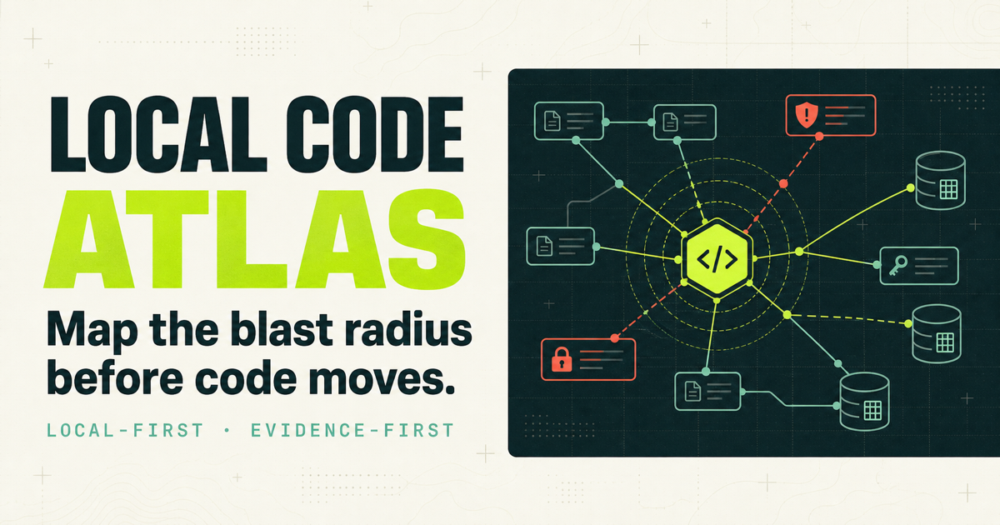
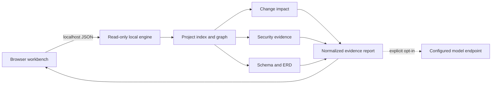

# Local Code Atlas

Local Code Atlas is a local-first code intelligence workbench. Point it at a
project directory, ask a change question, and inspect connected source, Git,
security, test, and database evidence in one report.



The project is intentionally evidence-first: deterministic analyzers produce
the findings, source locations, and confidence. An optional model adapter can
summarize that bounded evidence, but it is not required for analysis.

## What it does

- Detects languages, frameworks, package managers, build tools, and database
  signals from the selected project.
- Reads local Git state, including staged, unstaged, untracked, renamed, and
  user-selected base-revision changes. Compare the working tree, staged files,
  or any validated `revision...HEAD` range.
- Builds a best-effort file, symbol, import, call, and reference graph across
  common application languages.
- Ranks the likely change surface for a natural-language question and attaches
  project-relative file and line evidence.
- Suggests related existing tests or missing regression coverage.
- Detects credential candidates without returning their values, plus risky SQL,
  process execution, TLS, cryptography, deserialization, and configuration
  patterns.
- Inventories direct dependencies across npm, Python, Maven, Gradle, Cargo, and Go.
- Resolves direct and transitive npm versions from `pnpm-lock.yaml`,
  `package-lock.json`, and Yarn classic or Berry lockfiles without executing a
  package manager.
- Optionally checks exact dependency versions against
  [OSV advisories](https://osv.dev/).
- Derives tables, columns, keys, and declared or inferred relationships from SQL
  DDL/migrations, Prisma, TypeORM, and JPA sources.
- Shows relationships as a searchable ERD graph and keeps declaration origin
  separate from confidence.
- Separates change-related evidence from whole-project context and exposes
  complete, partial, skipped, and failed analyzer states.
- Optionally asks a configured chat-completions endpoint to synthesize only the
  selected, bounded, redacted evidence.

## Quick start

Prerequisites:

- Node.js 22 or newer
- pnpm 11 or a compatible pnpm release
- Git for change-aware analysis

For the shortest local-first flow, launch the workbench with a project already
selected:

```bash
pnpm install
pnpm launch /absolute/path/to/project
```

The launcher starts a new engine with the selected project as its exclusive
allowed root, starts the web process when needed, and opens the workbench. An
existing engine is reused only when its health contract confirms the same
exclusive root; an unrelated service or different root policy fails closed.
`ATLAS_WEB_URL` must also be loopback-only before the launcher adds a local path
to it. Pass `--no-open` when you do not want it to open a browser.

For development with hot reload, run:

```bash
pnpm dev
```

Open [http://localhost:3000](http://localhost:3000). The browser workbench runs
on port `3000` and the read-only local engine binds to `127.0.0.1:4317` by
default.

Choose **Run bundled sample** to verify the complete flow without selecting your
own project. The sample contains deliberate TLS and SQL interpolation risks and
a three-table relational schema.

## Analyze from the command line

The CLI prints the same normalized report as the browser API:

```bash
pnpm atlas /absolute/path/to/project \
  --base main \
  --question "If session expiry changes, what code, tests, risks, and tables are affected?" \
  --format markdown \
  --output atlas-review.md
```

Useful options:

- `--sample`: analyze the bundled synthetic project;
- `--staged`: analyze only changes already added to the Git index;
- `--base <revision>`: compare the merge base of a branch or commit with `HEAD`;
- `--scope production|all`: exclude or include tests, examples, fixtures,
  documentation, generated, and vendored sources;
- `--osv`: opt into a known-dependency advisory lookup;
- `--ai`: use the configured model adapter for evidence synthesis;
- `--format json|markdown|sarif`: choose a machine- or reviewer-friendly report;
- `--output <file>`: write the selected format to a file;
- `--question` or `-q`: set the impact question.

## Privacy model

Local analysis is the default. The engine does not execute project build hooks,
modify the selected repository, or persist source contents.

| Capability | Leaves the device? | Default |
| --- | --- | --- |
| Structure, Git, impact, source security, ERD | No | On |
| OSV advisory lookup | Package ecosystem, exact package name, and exact version | Off |
| AI synthesis | Project name and detected stack, question, relative evidence paths, bounded redacted impact/security evidence, table/column names | Off |

Local-only analysis is the default. Both networked capabilities require an
explicit checkbox or CLI flag. The OSV
lookup never sends source paths or source content. AI synthesis is unavailable
until an operator configures an endpoint and model; the workbench reads the
local health contract to identify the endpoint origin and every request category
before opt-in. The post-run receipt distinguishes fields that could be sent
from fields included in an actual network request.
Model endpoints accept only HTTP(S); non-loopback endpoints require HTTPS, and
redirects are rejected so evidence cannot move to an undisclosed origin.

When more than one user or process can reach the engine, set
`ATLAS_ALLOWED_ROOTS` and keep the default loopback host. Browser origins are
restricted to the local workbench by default.

The engine has no authentication layer. A non-loopback `ATLAS_HOST` therefore
refuses to start unless `ATLAS_ALLOWED_ROOTS` is explicitly configured; use a
separate authenticated boundary before exposing it beyond a trusted machine.

## Configuration

Copy the example only when you need non-default settings:

```bash
cp .env.example .env.local
```

Important variables:

| Variable | Purpose |
| --- | --- |
| `ATLAS_HOST`, `ATLAS_PORT` | Local engine bind address and port |
| `ATLAS_ALLOWED_ROOTS` | Comma- or platform-delimiter-separated scan roots |
| `ATLAS_ALLOWED_ORIGINS` | Browser origins allowed to call the engine |
| `ATLAS_MAX_FILES` | Maximum indexed files per request |
| `ATLAS_MAX_FILE_BYTES` | Maximum bytes read from one text file |
| `ATLAS_MAX_TOTAL_BYTES` | Cumulative project scan budget |
| `ATLAS_LLM_BASE_URL` | Chat-completions API base URL |
| `ATLAS_LLM_MODEL` | Runtime-selected model identifier |
| `ATLAS_LLM_API_KEY` | Optional bearer credential for that endpoint |
| `NEXT_PUBLIC_ATLAS_API_URL` | Browser-facing local analyzer URL |
| `ATLAS_WATCH_POLLING` | Optional dev-server polling when native file events are unavailable |

No model or provider is embedded in the source. A compatible local endpoint can
be used without an API key.

## Architecture



The browser never receives direct filesystem access. See
[docs/architecture.md](docs/architecture.md) for trust boundaries and analyzer
contracts, and [docs/api.md](docs/api.md) for the local HTTP contract.

## Development

```bash
pnpm lint
pnpm typecheck
pnpm test
pnpm build
pnpm test:render
```

`pnpm check` runs the complete verification sequence. Fixtures are synthetic and
live under `tests/**/fixtures` and `examples/sample-project`.

See [docs/roadmap.md](docs/roadmap.md) for the public-alpha, daily-review, and
extensibility milestones.

## Current limitations

- Relationships produced by regular-expression and convention parsers are
  best-effort; runtime reflection and dynamically assembled imports may be
  absent.
- Security findings are review leads, not proof of exploitability or a clean
  bill of health. Deep interprocedural data-flow proof is not part of this
  release.
- Production scope follows repository conventions. The CLI and workbench
  currently expose `production` and `all`; custom source-scope rules are a
  library-level extension through `ScanOptions.sourceScopeRules` until a
  validated project configuration file is added.
- SQL migration replay does not yet model every `DROP` or `RENAME` sequence.
- ORM naming strategies without explicit physical names are marked inferred.
- OSV lookup covers dependencies with exact resolved versions. Ranges and
  floating references without a supported lockfile resolution are deliberately
  excluded and reported as skipped coverage. The complete lookup has a bounded
  deadline configurable through `ATLAS_OSV_TIMEOUT_MS`.
- Live database connections are not supported; ERD output comes only from
  repository sources.

## Contributing and security

Please read [CONTRIBUTING.md](CONTRIBUTING.md) before opening a pull request.
Report security problems privately as described in [SECURITY.md](SECURITY.md).

Local Code Atlas is available under the [MIT License](LICENSE).
