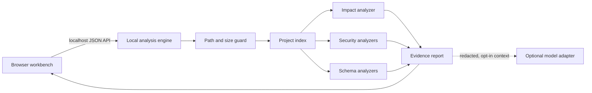

# Architecture

Local Code Atlas separates the browser interface from the process that can read
local files. This keeps the UI portable while making the trust boundary visible.

## Trust boundaries

The browser never reads arbitrary files directly. It sends a path and analysis
request to the loopback-only engine. The engine resolves the path, applies the
configured allowed roots, refuses broad system locations, enforces file and
byte budgets, and performs read-only inspection.

The scanner also assigns a configurable source role to every file. Production
analysis excludes examples, fixtures, documentation, generated code, and
vendored sources from the main graph while keeping tests available for impact
and coverage suggestions. Security and schema analysis use the stricter
production subset. An explicit `all` scope is available for repository-wide
audits.

The default analysis is deterministic. Optional model synthesis receives a
bounded, redacted evidence summary rather than an entire repository. Provider
URL, credential, and model are runtime configuration; the project does not
select or embed a provider-specific model.

Optional network features share one public field catalog across the health
endpoint and report composer. Before opt-in, the workbench shows the configured
endpoint origin and the fields a request would contain. After analysis,
`requestAttempted` and `transmitted` record actual request activity separately,
so a missing model configuration or an empty advisory set cannot look like a
completed transfer.

## Project graph

Files, symbols, imports, tests, database objects, and findings share source
provenance. An analyzer produces evidence nodes; the report composer connects
them instead of flattening independent tool output. This enables questions such
as “which endpoint reaches the table referenced by this finding?” without
claiming certainty that the underlying parser cannot support.

## Analyzer contract

Analyzers are selected from observed files and project metadata. Each returns:

- a stable identifier and category;
- normalized severity or confidence;
- a project-relative source location;
- redacted evidence suitable for display;
- a remediation or verification step;
- diagnostics when parsing is partial.

Declared relationships and inferred relationships remain distinguishable in the
API and interface through an origin field that is independent of confidence.
Analyzer completion is also explicit: skipped external checks, missing exact
versions, capped scans, and network failures cannot appear as a clean zero.

## Change review contract

Git comparison is selected per request: working tree, staged-only, or a
validated `revision...HEAD` range. Report composition attaches review relevance
to security findings and data objects using the shared impact ranking, which
combines selected changes, graph structure, and question terms. The first
release uses direct/indirect/project classifications; it does not claim that
these labels prove a Git change or a full interprocedural data-flow path.

Git inspection is command-scoped and read-only: optional lock creation is
disabled, repository or global `core.fsmonitor` helpers are overridden without
changing configuration, and diff calls explicitly disable external diff and
textconv drivers. Project hooks and configured helper programs are therefore
not part of the analysis path.

## Non-goals for the first release

- executing untrusted project code or build hooks;
- modifying a scanned repository;
- replacing a dedicated SAST, SCA, or database migration tool;
- claiming that the absence of findings proves security.
